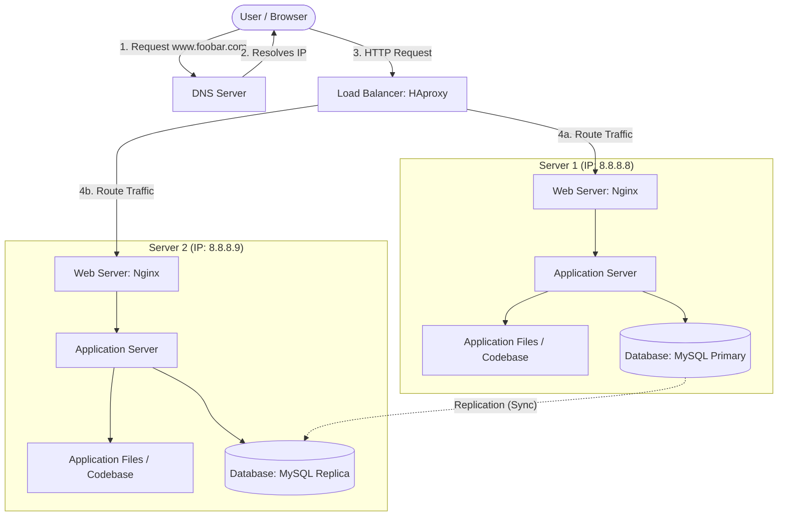

# Distributed Web Infrastructure

## Diagram

## Overview

This infrastructure scales the single-server setup into a distributed, multi-server architecture by introducing a load balancer to distribute traffic across two identical application servers, and establishing a database replication cluster to handle data consistency and availability.

## Specifics & Requirements

### Why add every additional element?

- **Load Balancer (HAproxy):** Added to distribute incoming traffic across multiple servers, preventing any single server from becoming overloaded and improving availability.
- **Second Server:** Added to share the processing load, provide redundancy, and ensure the application remains accessible even if one server fails.
- **Database Primary-Replica Setup:** Added to separate read and write operations, improve performance, and provide a backup copy of the data.

### Load Balancer Distribution Algorithm & How It Works

- **Algorithm:** Typically configured with Round Robin or Least Connections.
- **How it works (Round Robin):** The load balancer sequentially cycles through the list of backend servers, sending each new request to the next server in line.

### Active-Active vs. Active-Passive Setup

- **Active-Active:** Both servers (or load balancers) are concurrently processing requests and handling traffic. If one fails, the other absorbs its share immediately.
- **Active-Passive:** One node handles all active traffic while the secondary (passive) node sits idle, monitoring the primary node and taking over only if the primary fails.

> Our HAproxy setup in this project context usually points to an active traffic distribution across servers, but database replication typically operates in a primary/replica pattern.

### How a Database Primary-Replica (Master-Slave) Cluster Works

- The **Primary (Master)** node handles all write operations (`INSERT`, `UPDATE`, `DELETE`). Any changes made are recorded in a binary log (binlog).
- The **Replica (Slave)** node connects to the primary, reads the binary log events, and applies the exact same changes to its own local database copy to stay synchronized.

### Difference Between Primary and Replica Nodes Regarding the Application

- **Primary Node:** Handles write queries (and can handle reads) initiated by the application.
- **Replica Node:** Primarily handles read-only queries from the application to offload traffic from the primary node.

## Issues with this Infrastructure

### 1. Single Points of Failure (SPOF)

- The **Load Balancer (HAproxy)** is a SPOF; if it crashes, users cannot reach any backend servers.
- If the **Primary Database** fails, write operations will fail until a replica is promoted.

### 2. Security Issues

- **No Firewall:** Servers lack packet-filtering rules, leaving them exposed to unauthorized access and network attacks.
- **No HTTPS (SSL/TLS):** Traffic is transmitted in plain text (HTTP), making it vulnerable to packet sniffing and man-in-the-middle attacks.

### 3. No Monitoring

- There are no active monitoring or alerting tools (like Prometheus, Nagios, or Datadog) to track server health, CPU usage, memory, or error rates in real-time.
