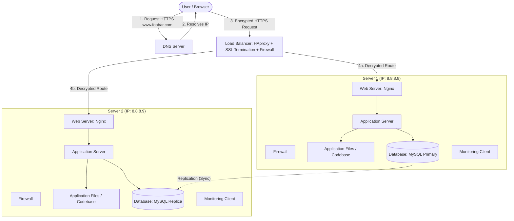

# Secured and Monitored Web Infrastructure

## Diagram

## Overview

This infrastructure builds upon the distributed web architecture by adding crucial security layers (firewalls and SSL/TLS encryption) and observability tools (monitoring clients) to ensure the system is secure, compliant, and actively supervised in real-time.

## Specifics & Requirements

### 1. Why add every additional element?

- **3 Firewalls:** Added to filter incoming and outgoing network traffic based on predefined security rules, protecting the servers from unauthorized access, DDoS attacks, and malicious payloads.
- **1 SSL Certificate:** Added to enable secure HTTPS communication, encrypting data in transit between the user's browser and the load balancer to protect sensitive information (like passwords and personal data).
- **3 Monitoring Clients:** Added to collect system metrics (CPU, memory, disk usage, QPS) and forward them to a centralized monitoring server (e.g., Datadog, Prometheus, or Sumo Logic) to ensure high availability and quick incident response.

### 2. What are firewalls for?

Firewalls act as a barrier between trusted internal networks and untrusted external networks (like the internet). They inspect network packets and allow or block them based on security policies, preventing unauthorized intrusions.

### 3. Why is the traffic served over HTTPS?

Traffic is served over HTTPS (HTTP Secure) using SSL/TLS encryption to ensure that data exchanged between the client and the server remains confidential, integral, and authenticated, protecting against Man-in-the-Middle (MitM) attacks and eavesdropping.

### 4. What monitoring is used for?

Monitoring is used to track the health, performance, and availability of servers and applications in real-time. It helps engineering teams detect bottlenecks, high resource utilization, errors, or service outages before they impact end users.

### 5. How the monitoring tool is collecting data?

Monitoring tools typically use a lightweight agent (monitoring client) installed on each server. This agent periodically gathers system metrics from the operating system (kernel, CPU, RAM) and application logs, then pushes or exposes this data to a central monitoring server.

### 6. How to monitor your web server QPS (Queries Per Second)?

To monitor QPS:

1. Configure the web server (like Nginx) to log access requests with timestamps.
2. Use a log parser or monitoring agent (such as Datadog or Prometheus with an Nginx exporter) to analyze the access logs or status page metrics in real-time.
3. Calculate the number of requests received per second divided by the time interval.

## Issues with this Infrastructure

### 1. Why terminating SSL at the load balancer level is an issue?

- **Traffic in the Internal Network is Unencrypted:** Once the load balancer decrypts the HTTPS traffic, communication between the load balancer and the backend application servers typically flows in plain text (HTTP). If an attacker breaches the internal network, they can sniff this traffic.
- **Single Point of Failure / Performance Bottleneck:** All decryption overhead is handled by the load balancer, increasing its CPU load and making it a critical bottleneck.

### 2. Why having only one MySQL server capable of accepting writes is an issue?

- **Write Bottleneck:** All write operations (`INSERT`, `UPDATE`, `DELETE`) must go through a single primary database, limiting scalability for write-heavy applications.
- **SPOF for Writes:** If the primary database crashes, the application becomes read-only until a replica is manually or automatically promoted to primary, causing downtime for write actions.

### 3. Why having servers with all the same components might be a problem?

- **Resource Inefficiency:** Combining web servers, application servers, and databases on the same physical or virtual machines creates resource contention (e.g., MySQL and Nginx competing for RAM and CPU).
- **Complex Scaling:** Scaling a specific tier independently (e.g., needing more web server capacity without needing more database instances) is difficult when all components are tightly coupled on the same servers.
