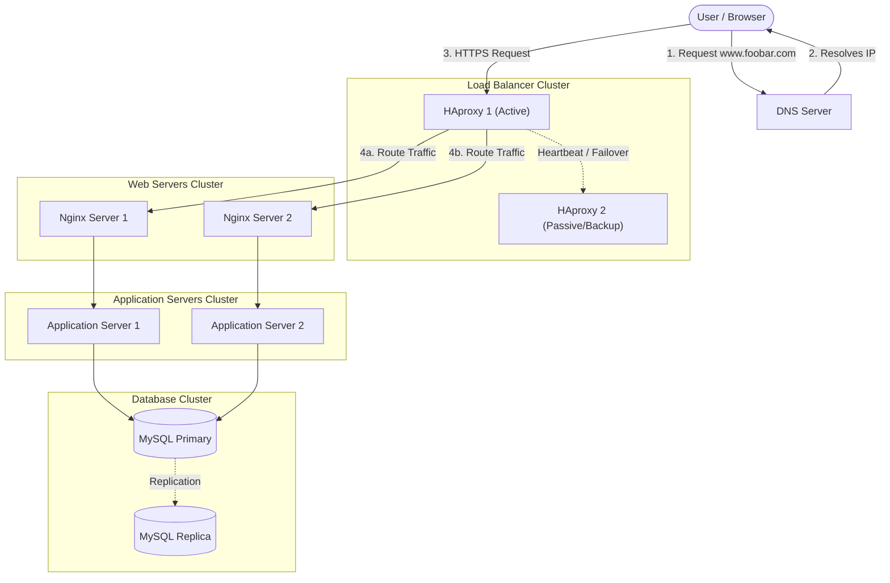

# Scale Up

## Diagram

## Overview

This architecture scales up the infrastructure by separating every core component onto its own dedicated tier (Web servers, Application servers, and Databases), introducing a clustered Load Balancer setup for high availability, and expanding the server count to optimize performance, fault tolerance, and resource allocation.

## Specifics & Requirements

### Application Server vs. Web Server

**Web Server (e.g., Nginx, Apache):**

- Responsible for handling incoming HTTP/HTTPS requests from clients.
- Specialized in serving static content directly (HTML, CSS, JavaScript, images) very quickly.
- Acts as a reverse proxy to forward dynamic requests to the appropriate application server.

**Application Server (e.g., Node.js, Tomcat, Flask):**

- Executes the core business logic, code execution, and data processing of the application.
- Interacts with databases and internal APIs to generate dynamic content before returning the rendered response back to the web server.

### Why Add Every Additional Element?

- **1 Additional Server:** Added to allow the complete decoupling of components. Instead of running all services on the same machine, servers are now dedicated to specific tiers (Web, App, DB), eliminating resource contention.
- **1 Additional Load-Balancer (HAproxy Cluster):** Added to eliminate the Load Balancer as a Single Point of Failure (SPOF). Configured in a high-availability cluster (Active-Passive or Active-Active), if the primary load balancer fails, the secondary takes over seamlessly to maintain uptime.
- **Component Splitting (Web Server, Application Server, Database on Separate Servers):**
  - **Performance & Optimization:** Each server type is tuned specifically for its workload (e.g., high I/O for web servers, high CPU/RAM for application servers, disk-optimized storage for databases).
  - **Independent Scalability:** If application traffic surges, you can scale out only the application servers without needing to duplicate database or web instances.
